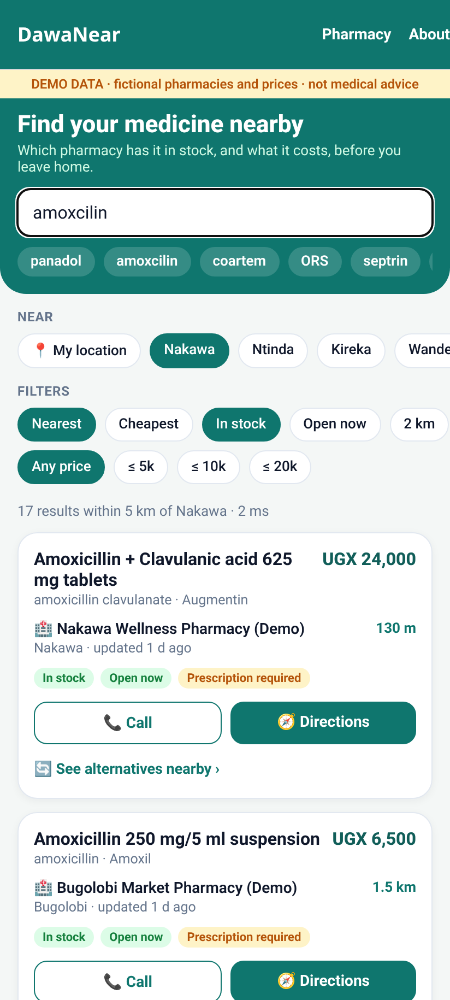
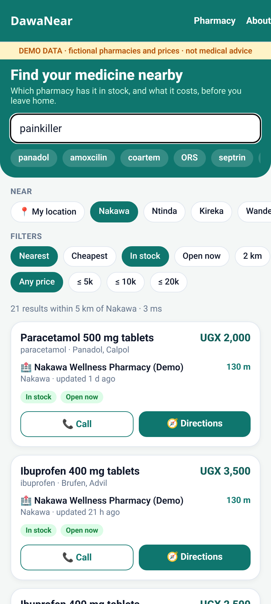
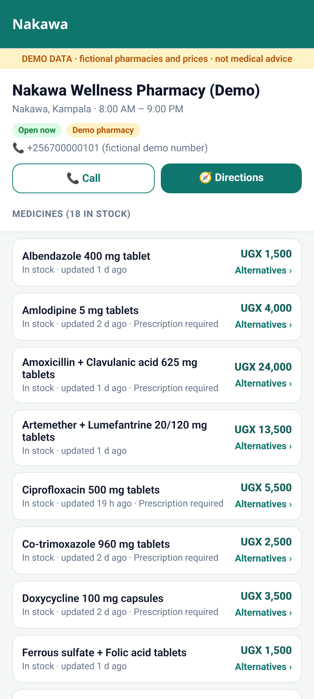
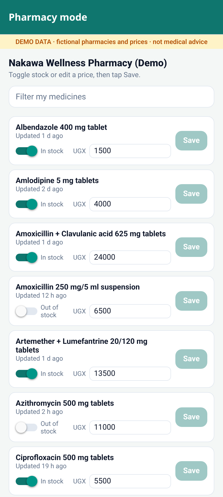
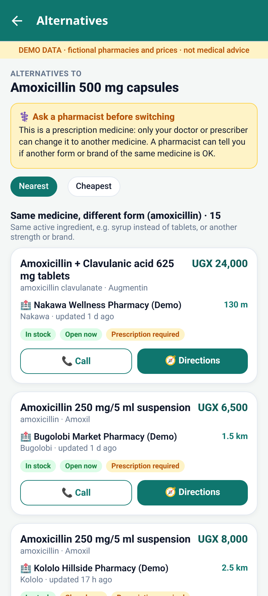
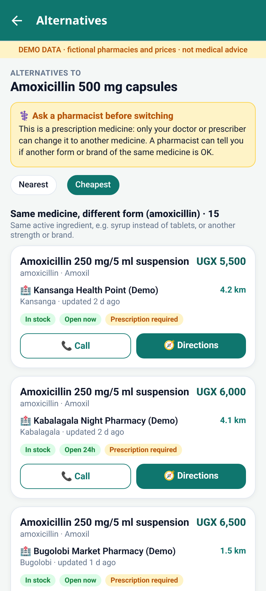
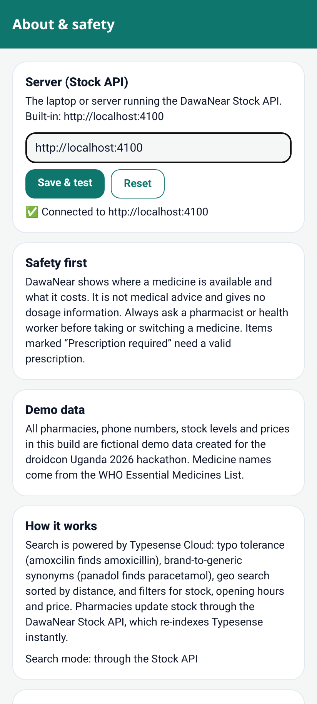

# DawaNear 💊📍

**Find the medicine you need at a pharmacy near you, before you leave home.**

DawaNear is a mobile app for Kampala. You type a medicine name, even with a spelling
mistake like `amoxcilin` or a brand name like `panadol`, and you see in milliseconds which
nearby pharmacies have it **in stock**, **what it costs**, **how far away** they are and whether
they are **open now**. One tap calls the pharmacy or opens directions in Google Maps.
Pharmacists keep their stock and prices up to date from a simple screen in the same app.

Built for the **droidcon Uganda hackathon**. Search is powered by **Typesense**.

> ⚠️ **Demo data only.** All pharmacies, phone numbers, stock levels and prices in this repo are
> fictional (marked "(Demo)"). DawaNear is not medical advice. Always talk to a pharmacist or
> clinician, and never take prescription medicine without a prescription.

## Screenshots (Expo web)

| Search (typo) | Synonym search | Pharmacy | Pharmacist |
|---|---|---|---|
|  |  |  |  |

| Alternatives (nearest) | Alternatives (cheapest) | Server setting |
|---|---|---|
|  |  |  |

## How Typesense is used

| Feature | Where |
|---|---|
| **Typo tolerance**: `amoxcilin` → Amoxicillin, `coartem` → Artemether + Lumefantrine | `api/src/lib/query.ts` (`num_typos: 2` over name, generic and brand fields) |
| **Synonyms**: `panadol` ⇄ paracetamol, `septrin` ⇄ co-trimoxazole, `painkiller` → paracetamol / ibuprofen | `api/src/data/synonyms.ts` (synonym set `medicine-synonyms`) |
| **Geo search**: only pharmacies within 2 / 5 / 10 km, sorted by distance | `filter_by: location:(lat, lng, 5 km)`, `sort_by: location(lat,lng):asc` |
| **Filters**: in stock, open now (Kampala time), max price | `filter_by` on `in_stock`, `opens_min`/`closes_min`/`open_24h`, `price_ugx` |
| **Sort**: nearest or cheapest, best text match first | `_text_match(buckets: 3):desc` then distance or price |
| **Real-time updates**: a pharmacist taps Save and the next search shows the change | `PUT /pharmacies/:id/stock/:medicineId` upserts one Typesense document |
| **Alternatives**: the same active ingredient in another form or brand, plus other medicines in the same class, in stock nearby | `GET /alternatives/:medicineId`: two parallel searches, `active_ingredients:=[…]` and `category:=… && active_ingredients:!=[…]`, inside a geo radius, sorted by distance or price |

Collections: `stock` (one document per pharmacy × medicine; this is what the app searches),
`medicines` and `pharmacies`.

## Project layout

```
dawanear/
  api/   Node + TypeScript "Stock API" (Express). Seeds Typesense, takes pharmacist updates, proxies search
  app/   Expo (React Native + TypeScript, Expo Router) mobile app: search, pharmacy, pharmacist, about
  docs/  screenshots
```

By default the phone **never holds a Typesense key**: it searches through the Stock API's
`/search` endpoint. Optionally, after you create a **search-only** key, the app can query Typesense
directly (see `app/.env.example`).

## Alternatives screen

If a medicine is out of stock or too expensive, tap **🔄 See alternatives nearby** on a search
result, or **Alternatives ›** next to a medicine on a pharmacy page. The screen shows two lists:

1. **Same medicine, different form**: the same active ingredient(s), e.g. amoxicillin capsules vs syrup.
2. **Other medicines in the same class**: e.g. other antibiotics or other blood-pressure medicines.

Use **Nearest** or **Cheapest** to sort. Only in-stock items within 10 km are shown. A note at the
top always says **"⚕️ Ask a pharmacist before switching"**. For prescription medicines it also says
that only the prescriber can change the medicine. DawaNear never suggests a dose.

## Run it on Windows (PowerShell)

You need **Node.js 20 LTS or newer** (https://nodejs.org), and **Expo Go** on your Android phone
(Play Store). The phone and laptop must be on the **same Wi-Fi** (or use `--tunnel`, see below).

### 1. Get a Typesense cluster

Use Typesense Cloud (https://cloud.typesense.org). In the cluster dashboard, copy the **host** and an
**admin API key**. Keep the key secret. It only goes in `api\.env`, which git ignores.

### 2. Start the Stock API

```powershell
cd dawanear\api
npm install
copy .env.example .env
notepad .env          # paste TYPESENSE_HOST and TYPESENSE_API_KEY, then save
npm run seed          # creates collections + synonyms and loads the demo data (run once)
npm run dev           # API on http://localhost:4000
```

Check it in a browser: http://localhost:4000/health shows `{"ok":true}`, and
http://localhost:4000/search?q=amoxcilin&lat=0.33&lng=32.615 returns results.

If Windows Firewall asks about Node.js, click **Allow** (private networks), so your phone can reach it.

### 3. Start the app

Open a **second** PowerShell window:

```powershell
ipconfig              # note your Wi-Fi "IPv4 Address", e.g. 192.168.1.23
cd dawanear\app
npm install
copy .env.example .env
notepad .env          # set EXPO_PUBLIC_API_URL=http://192.168.1.23:4000 (your IP), then save
npx expo start
```

Scan the QR code with **Expo Go**. If the phone can't connect, try `npx expo start --tunnel`.
The API must still be reachable from the phone, so use the same Wi-Fi or expose port 4000.
Press `w` to open the web version in your browser.

### Demo pharmacy codes (pharmacist screen)

Tap **Pharmacy** in the top bar, choose an area and enter its code:

| Pharmacy | Code | | Pharmacy | Code |
|---|---|---|---|---|
| ph01 Nakawa | 1111 | | ph06 Wandegeya | 6666 |
| ph02 Ntinda | 2222 | | ph07 Kololo | 7777 |
| ph03 Kireka (24h) | 3333 | | ph08 Kabalagala (24h) | 8888 |
| ph04 Bukoto | 4444 | | ph09 Naalya | 9999 |
| ph05 Kansanga | 5555 | | ph10 Bugolobi | 1010 |

These are demo codes, set in `PHARMACY_CODES` in `api\.env`. Change them for any real use.

### Low-RAM laptop tips (about 4 GB)

- Close Chrome tabs and Android Studio. You don't need an emulator, because Expo Go on your phone is lighter.
- Run only `npm run dev` (API) and `npx expo start` (app). Nothing else is needed.
- If Metro is slow or crashes: `npx expo start -c` (clears the cache).
- For a lighter API: `npm run build` then `npm start` (the API is capped at 128 MB).

## Tests

```powershell
cd dawanear\api; npm run typecheck; npm test     # 26 tests (query builder, alternatives, endpoints, fake Typesense)
cd ..\app;       npm run typecheck; npm test     # 19 tests (formatting, search params, result card, alternatives screen, server setting)
```

## Android APK (for judges / demo phones)

A ready-made **debug-signed release APK** is included with the submission (`dawanear-preview.apk`).
Install it on an Android phone (allow "install unknown apps"). It needs no Expo Go and no Expo account.

**Which server does it talk to?** The built-in address is `http://192.168.137.1:4000`. That is your
laptop's address when you turn on **Windows Mobile Hotspot** (Settings → Network → Mobile hotspot) and
connect the phone to it. Then start the API (`npm run dev`) and the app works.

**Different network?** You don't need to rebuild. In the app, open **About** (top bar) → **Server
(Stock API)**, type `http://<laptop IPv4 from ipconfig>:4000` or a deployed `https://…` URL, and tap
**Save & test**. ✅ means it is connected. **Reset** goes back to the built-in address. The phone
remembers the setting. Plain `http://` is allowed on purpose, so a laptop on the venue Wi-Fi works.

### Rebuild the APK with another built-in URL

**Option A: local build (Linux/macOS/WSL, about 8 GB RAM, no Expo account).** This is how the
included APK was built: JDK 17, Android SDK (platform 37, build-tools 37, NDK 27.1.12297006).

```bash
export JAVA_HOME=/path/to/jdk17 ANDROID_HOME=/path/to/android-sdk
cd app && npm install
EXPO_PUBLIC_API_URL=https://your-api.example.com npx expo prebuild -p android --clean
cd android && NODE_ENV=production EXPO_PUBLIC_API_URL=https://your-api.example.com ./gradlew assembleRelease
# → android/app/build/outputs/apk/release/app-release.apk
```

A 4 GB Windows laptop is too small for this build. Use option B there.

**Option B: EAS cloud build (any laptop, needs your own free Expo account).**

```powershell
cd dawanear\app
npm install -g eas-cli
eas login
eas build -p android --profile preview
```

EAS builds in the cloud, so it does not see your PowerShell variables. The built-in URL comes from
`"env": {"EXPO_PUBLIC_API_URL": …}` in `app/eas.json` (preview profile), so change it there first.
EAS gives you a link to download the `.apk`.

## API endpoints

| Method | Path | What |
|---|---|---|
| GET | `/health` | status |
| GET | `/search?q=&lat=&lng=&radius_km=&in_stock=&open_now=&max_price=&sort=distance\|price\|relevance` | Typesense stock search |
| GET | `/alternatives/:medicineId?lat=&lng=&radius_km=&sort=distance\|price` | `{medicine, same_ingredient, same_class}`: in-stock alternatives nearby (404 if unknown) |
| GET | `/pharmacies`, `/pharmacies/:id` | pharmacy list and detail with stock |
| GET | `/medicines?q=` | medicine list |
| POST | `/pharmacy/login` | `{pharmacyId, code}` → checks the demo code |
| PUT | `/pharmacies/:id/stock/:medicineId` | header `X-Pharmacy-Code`, body `{in_stock, price_ugx}` → updates Typesense |
| POST | `/admin/sync` | re-index everything (optional `SYNC_TOKEN`) |

## Data

- **Medicines**: 30 common medicines from the WHO Model List of Essential Medicines (generic names, strengths and common brand names). Prices are invented for the demo.
- **Pharmacies**: 10 fictional pharmacies placed in real Kampala neighbourhoods, with made-up names, phone numbers and hours.
- **Stock**: generated with a fixed random seed, so every run gives the same demo data.

## AI-use disclosure

This project was built during the hackathon with help from an AI coding assistant (Grok Bot).
The assistant generated much of the code, tests, demo data and this README, and set up the
Typesense cluster, all under the direction of the team, who reviewed and tested it and made the
product decisions. All code was written fresh for this hackathon. The demo medicine synonyms
(brand ⇄ generic) should be checked by a pharmacist before any real use.

## License

MIT, for hackathon purposes.
